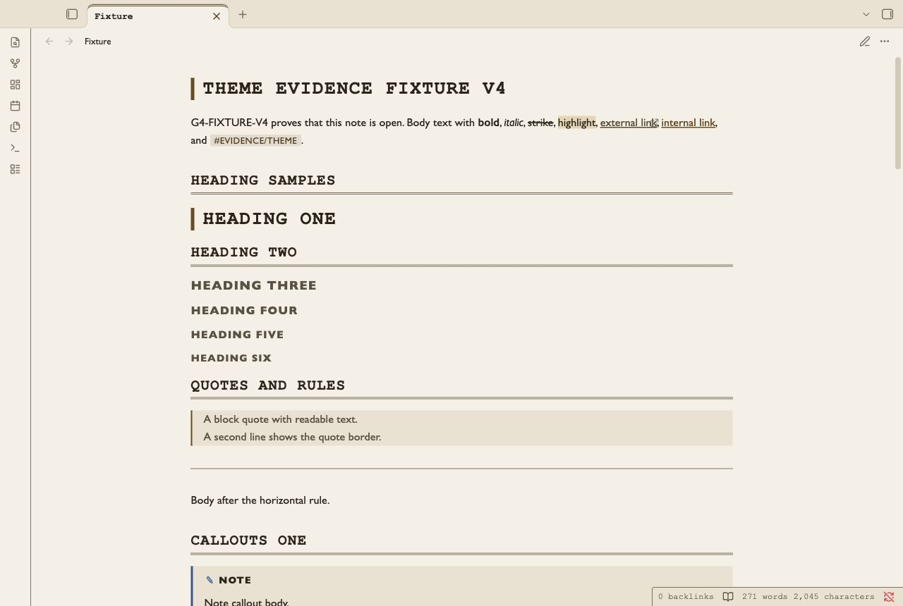
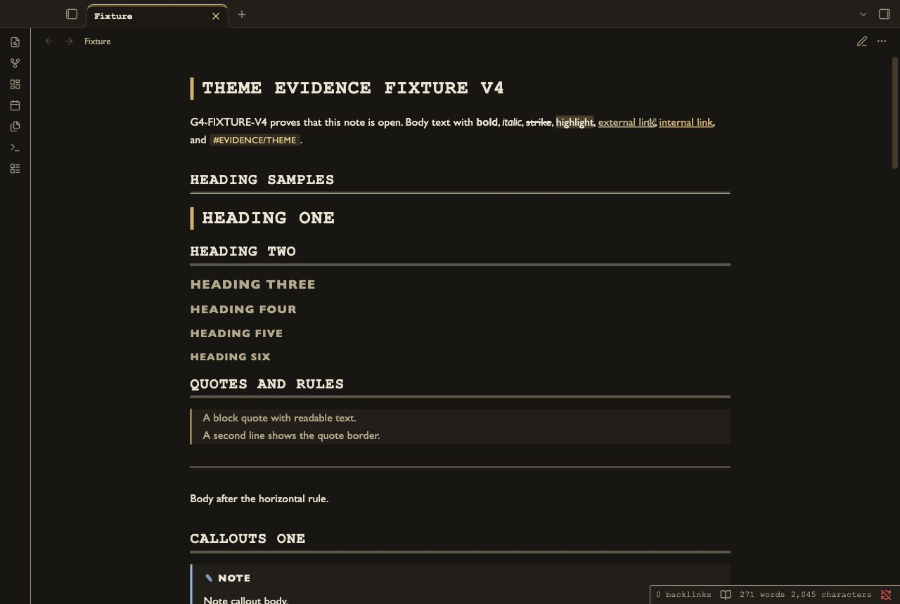
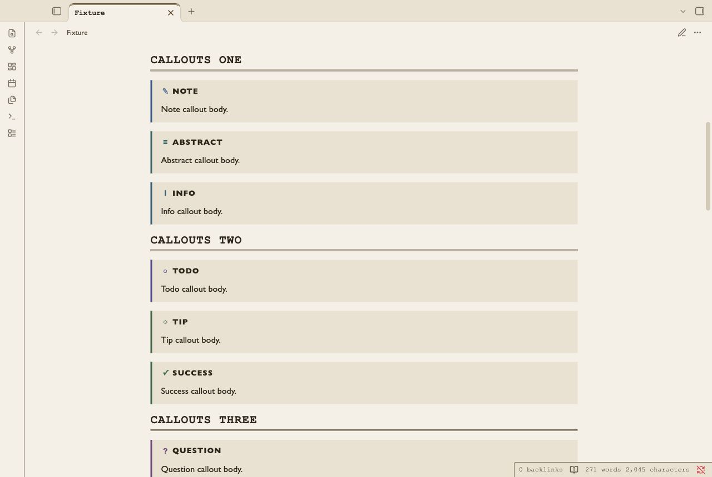
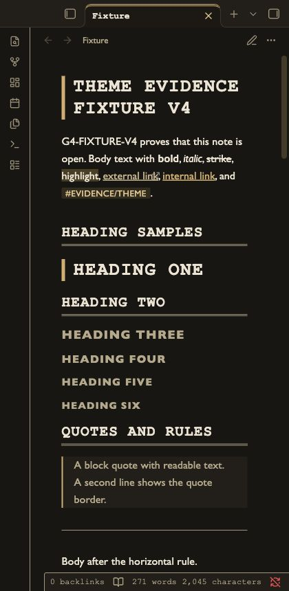

# Finding Aid

A light and dark Obsidian theme for archive inventories.
Catalogue headings, inventory rules and square cards keep collection notes easy to scan.
Callouts keep their type icons and colored edges. Warning uses a double edge.
Keyboard controls have a focus ring. The editor uses a colored caret and an active-line rail.

## Screenshots






## Install

1. Open your vault folder.
2. Create `.obsidian/themes/Finding Aid/`.
3. Copy `theme.css` and `manifest.json` into that folder.
4. Open Obsidian Settings → Appearance.
5. Select **Finding Aid** in the theme list.

## Uninstall

1. Select the default theme in Settings → Appearance.
2. Remove `.obsidian/themes/Finding Aid/` from your vault.

## Compatibility

Minimum Obsidian version: 1.4.0.
The desktop renderer is tested with the G4 native Obsidian capture harness.
The 420 px screenshots show a narrow desktop window.
Mobile is not tested. Community-directory installation is not tested.

## Customization

Add a CSS snippet in your vault. Enable it in Settings → Appearance.

```css
body.theme-light, body.theme-dark {
  --file-line-width: 46rem;
  --h1-size: 1.8em;
  --list-indent: 1.6em;
}
```

Change `--text-accent` and `--background-modifier-border-focus` together to adjust the accent.
Check contrast after a color change. Style Settings controls are not included.

## Known limits

Monospaced catalogue headings use more width than body text. Long identifiers can wrap.
System fonts can differ between computers.
Native Obsidian controls determine keyboard reachability.
Automated contrast checks do not certify screen-reader access.
Startup console events before the harness attaches are unknown.
Independent design review is pending.

## License

MIT. See [LICENSE](LICENSE).
